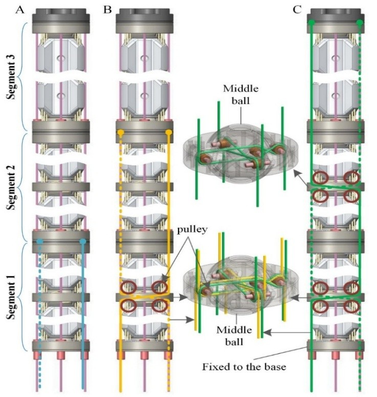
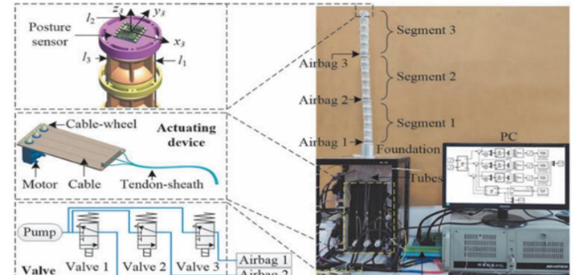
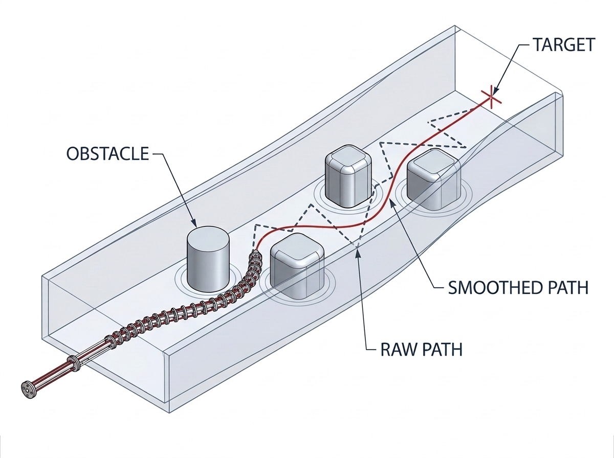

<div align="center">

# 南京江鸟科技有限公司 · 官方网站项目
### NANJING JIANGNIAO TECHNOLOGY — “混天绫”超细长重载柔性机械臂

[](https://www.jiangniao-tech.com/)
[](https://www.jiangniao-tech.com/#endorse)
[](https://www.jiangniao-tech.com/#endorse)
[](https://www.jiangniao-tech.com/#about)

**化绕指柔为百炼钢 —— 专攻航空、核电、石化狭小密闭腔体原位无损检测与运维**

[🌐 访问正式官网 (www.jiangniao-tech.com)](https://www.jiangniao-tech.com/) · [📦 产品选型矩阵](https://www.jiangniao-tech.com/#products) · [🔬 三层柔索核心技术](https://www.jiangniao-tech.com/#tech) · [📩 B2B 预约演示与询盘](https://www.jiangniao-tech.com/#contact)

</div>

---

## 一、 项目背景与业务定位

在航空器密闭隔框、核电高辐射储罐、石化反应釜及异形压力管道等高端装备运维场景中，大量结构缺陷隐藏在仅 **30–60 mm** 的狭窄检修口之后——**刚性机械臂“钻不进”、传统人工内窥“检不全”、普通柔性臂伸展后刚度骤降“行不稳”**，国内高端柔性检测装备存在显著的国产化缺口。

**南京江鸟科技有限公司**依托江苏省智能制造重点实验室与江苏省重点研发计划（项目号：`BE2024153`），自主研制 **“混天绫”系列超细长重载柔性机械臂**。通过首创的**内-中-外三层柔索解耦结构**、**逆反馈关节解耦驱动**与**无地图狭小腔体避障规划算法**，实现“不拆一颗螺栓，完成一次内部全面体检”。

---

## 二、 硬核技术指标基准（江苏省特检院中试核验）

| 核心指标项 | 实测参数值 | 技术突破与工程意义 |
| :--- | :---: | :--- |
| **极限长径比** | **`50.6 : 1`** | 3.0 m 臂长仅 60 mm 外径（短臂型外径仅 30 mm），轻松穿过标准手孔与隔框 |
| **末端最大负载** | **`6.0 kg`** | 可同时搭载双光谱高清视觉、超声相控阵探头、电动夹爪或内壁清理模组 |
| **刚度可调范围** | **`62 – 4300 N/m` (70×)** | 柔顺穿行进入、受压刚度瞬时锁死提升 70 倍，伸展自支撑无下垂 |
| **重复定位精度** | **`±0.6 mm`** | 小试实测稳态定位误差 `≤ 1.0 mm`（全行程 `＜ ±1.7 mm`），支撑定量无损探伤 |
| **动态阶跃响应** | **`≤ 0.1 s`** | 自研逆反馈解耦算法毫秒级补偿段间耦合干扰，消除长臂重载震荡 |
| **中试良品率 & 寿命** | **`95.0 %` / `20,000 次`** | 通过江苏省特检院立罐 18 次、卧罐 21 次及 20,000 次连续弯折考核，服役寿命 8–10 年 |

---

## 三、 三项底层技术突破

### 1. 结构层面：内-中-外三层柔索解耦结构
- **原理**：三层柔索在段内耦合、段间通过滑轮与中间球铰（Middle Ball & Pulley）实现力学解耦，依靠索力分配实现“刚柔一体”。
- **核心指标**：`70×` 刚度动态变化范围 · `50×` 承载能力提升 · `R ≥ 0.2 m` 极限转弯半径。
- **知识产权**：核心发明专利《一种空间站的机械臂装置》（专利号：`2024117977991`）。

<div align="center">
  
  <br>
  <sub><b>Fig. 01 / 内-中-外三层柔索滑轮与中间球铰解耦结构示意图</b></sub>
</div>

### 2. 控制层面：逆反馈关节解耦驱动系统
- **原理**：集成末端三维姿态传感器（Posture Sensor）、电机-索轮驱动阵列（Actuating Device）与气囊变刚度阀控回路（Airbag & Valve），将段间耦合干扰在毫秒级内实时补偿，粗精同驱。
- **核心指标**：`≤ 0.1 s` 动态阶跃响应 · `≤ 1.0 mm` 稳态定位误差 · `66.7%` 重复定位精度提升（单段最大弯曲 `180°`）。

<div align="center">
  
  <br>
  <sub><b>Fig. 02 / 逆反馈关节解耦驱动与多回路闭环控制实验台架</b></sub>
</div>

### 3. 智能层面：无地图避障规划与轨迹平滑
- **原理**：面向未知或无先验地图的狭小非结构化腔体，以局部最优解配合安全梯度场策略降维，将剧烈折返的原始路径（`RAW PATH`）实时收敛为高阶连续平滑轨迹（`SMOOTHED PATH`）。
- **核心指标**：`26%+` 轨迹平滑性提升 · `≥ 95%` 未知腔体避障成功率 · `36.7%` 自适应安全裕度提升。
- **知识产权**：国家软件著作权《检测探测用变刚度连续体机器人控制软件 V1.0》（登记号：`2024SR1758359`）。

<div align="center">
  
  <br>
  <sub><b>Fig. 03 / 狭小工业腔体无地图自主避障与轨迹平滑规划示意图</b></sub>
</div>

---

## 四、 “混天绫”系列产品与解决方案矩阵

| 设备型号 | 机型定位 | 臂长 / 外径 | 关节数 | 额定负载 | 工作空间包络 | 重复精度 | 标准成套参考价 | 典型应用场景 |
| :--- | :--- | :---: | :---: | :---: | :---: | :---: | :---: | :--- |
| **`QZSZC001-06`** | 短臂高载型 | `1.8 m / 30 mm` | 6 关节 | **`6.0 kg`** | `R = 1.2 m` 球体 | `±0.6 mm` | **30 万元/台** | 航空蒙皮隔框夹层、发动机短舱检视与异物拾取 |
| **`QZSZC001-08`** | 标准主力型 | `2.4 m / 44 mm` | 8 关节 | **`5.6 kg`** | `⌀1.1 m × 1.8 m` | `±0.6 mm` | **35 万元/台** | 石化压力容器、反应釜、换热器及重型装备深腔探伤 |
| **`QZSZC001-10`** | 大纵深长臂型 | `3.0 m / 60 mm` | 10 关节 | **`5.2 kg`** | `⌀1.0 m × 1.5 m` | `±0.6 mm` | **40 万元/台** | 核电高辐射储罐、大纵深曲折管路、船舶双层底检测 |

> **三种灵活商业交付模式**：
> 1. **标准成套设备销售**（`30–40 万元/台`）：含柔性机械臂本体、多电机解耦驱动控制箱、V1.0 上位机软件与末端快换接口。
> 2. **现场驻场检测技术服务**（`3,000 元起/次` 或 `2–4 万元/月`）：江鸟工程师携设备入场作业，20–30 分钟出具定量无损检测报告。
> 3. **特殊腔体非标定制开发**（`50 万元起/台`）：面向极端孔径、耐辐照防爆或特殊作业末端按需定制。

---

## 五、 官网前端架构与工程特性

本项目采用**零构建依赖、高内聚、极速加载**的现代静态 Web 架构设计，严格遵循机械科技高端装备 UI/UX 规范：

### 1. 视觉与交互亮点
- **精密极简风设计系统（Precision Minimalist UI）**：采用 `#F8FAFC` 浅冷灰与纯白底色，搭配 `#1E3A8A` 深钢蓝品牌主色与 `#0284C7` 精密蓝点缀，契合高端工业检测仪器质感。
- **Monospace 硬核指标看板**：全站核心技术参数、遥测 HUD 面板及公差指标统一采用等宽字体（`JetBrains Mono` / `Barlow Condensed` / `Consolas`）高对比呈现，以精确数据建立 B2B 技术信任。
- **Lucide 线性矢量图标系统**：全站内联 `lucide-icons` 风格高颜值线性 SVG 图标，零外部图标字体请求。
- **产品矩阵多维前端筛选 & 横向对比表**：支持按应用场景（航空隔框 / 压力容器 / 核电储罐）实时筛选机型，并支持一键展开三机型全参数对比表。
- **30 秒智能工况选型配置器 & 免拆检 ROI 测算器（借鉴 Eddyfi / Waygate NDT & Modular Showroom）**：支持拖动滑块输入现场检修口最小孔径（`30–120 mm`）、探测纵深（`1.0–3.0 m`）、末端负载（`1.0–6.0 kg`）及年检频次，实时匹配推荐机型（或非标细径方案）、测算年均节省拆检成本与投资回收周期（基于 87% 免拆检降本基准），并支持一键将工况参数带入询盘单。
- **工程师高频技术问答 FAQ 手风琴（借鉴 ScrewFast 工业 B2B 模板）**：针对断电安全回抽冗余、第三方探头快换兼容、高辐射/强腐蚀防护及交付培训周期提供标准化工程解答。
- **Schema.org JSON-LD 结构化数据 & 顶部阅读进度条**：内置 `Organization` 结构化 SEO 元数据，强化搜索引擎与 AI 检索收录表现。
- **在线动态生成标准化 A4 PDF 技术规格书**：无需后端服务器，点击任意机型的「PDF 规格书」即可实时渲染带公司抬头、文档编号、执行标准、完整参数表与认证背书的 A4 规格书页面，并自动唤起打印/另存为 PDF。
- **轻量化 B2B 询盘闭环**：导航栏右上角、每张产品卡底部、产品详情弹窗及右下角浮动栏均固定设有「获取报价 / 预约样机演示」入口，点击自动带入所选型号，支持**一键唤起邮件客户端**或**一键复制格式化询盘单（直接粘贴发微信）**。
- **CAD 工程图全屏放大查看器**：点击核心技术板块的三张工程图（`Fig. 01 ~ Fig. 03`）即可全屏高清查看细节标注。

### 2. 仓库目录结构

```text
.
├── index.html                    # 生产环境标准入口文件（精密极简正式版，相对路径引用 assets/）
├── 南京江鸟科技官网-优化版.html     # 本地双击预览副本（与 index.html 同步）
├── 南京江鸟科技官网.html           # 原始历史单文件存档备份（Base64 内嵌版）
├── wrangler.jsonc                # Cloudflare Workers Static Assets 自动部署配置
├── .assetsignore                 # 静态部署排除列表（仅发布 index.html 与 assets/）
├── README.md                     # 项目架构与业务讲解文档
└── assets/                       # 网站静态图片资源目录（共 19 张）
    ├── hero-1.jpg ~ hero-3.jpg         # 首屏轮播图（现场作业 / 产品特写 / 展会展示）
    ├── product-06.jpg ~ product-10.jpg # 混天绫 06 / 08 / 10 三款定型产品图
    ├── tech-01.jpg                     # Fig. 01 内-中-外三层柔索滑轮与球铰解耦结构图
    ├── tech-02.png                     # Fig. 02 逆反馈关节解耦驱动与闭环控制实验台架图
    ├── tech-03.jpg                     # Fig. 03 狭小腔体无地图避障与轨迹平滑规划 CAD 图
    ├── case-aviation.jpg               # 工程案例：东部机场航空器蒙皮隔框检修
    ├── case-nuclear.jpg                # 工程案例：秦山核电水合肼储罐非拆卸原位检测
    ├── case-field.jpg                  # 工程案例：石化压力容器与异形管道现场检测
    ├── case-pilot.jpg                  # 工程案例：江苏省特检院 20,000 次弯折中试台架
    ├── about-1.jpg ~ about-2.jpg       # 关于我们：团队展会与工业现场调试实拍
    └── news-1.jpg ~ news-4.jpg         # 新闻动态配图（CCTV 报道 / 国赛总决赛 / 特检院中试 / 核电应用）
```

---

## 六、 本地运行与自动化部署（CI/CD）

### 1. 本地预览
本项目为纯静态标准 HTML5 架构，无需安装 Node.js 或执行编译构建：
- **方式 A（直接双击）**：克隆或下载本仓库后，直接用浏览器双击打开 `index.html`。
- **方式 B（本地 HTTP 服务）**：
  ```bash
  git clone https://github.com/ydor0212/web.git
  cd web
  python -m http.server 8000
  # 浏览器访问 http://127.0.0.1:8000
  ```

### 2. 生产环境自动化部署架构
本仓库已接入 **GitHub → Cloudflare Workers Static Assets** 自动化部署流水线并绑定正式域名：
- **正式生产域名**：[https://www.jiangniao-tech.com/](https://www.jiangniao-tech.com/)
- **自动更新机制**：向 `main` 分支推送（`git push origin main`）任何代码或图片更新后，Cloudflare 边缘节点将在 20–30 秒内自动拉取最新提交并完成全球与国内 CDN 刷新。

---

## 七、 商务合作与技术联系

- **研发制造基地**：江苏省南京市 · 江苏装备产业园（1200 ㎡ 现代化研发与装配产线）
- **技术与商务热线**：`025-8888 6666`
- **官方询盘邮箱**：`contact@jiangniao-tech.com`
- **官方网站**：[https://www.jiangniao-tech.com/](https://www.jiangniao-tech.com/)

---

<div align="center">
  <sub>© 2026 南京江鸟科技有限公司 (Nanjing Jiangniao Technology Co., Ltd.) · 保留所有权利</sub>
</div>
